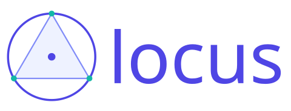

<p align="center">
  <a href="assets/locus-logo.locus">
    
  </a>
</p>

# Locus

Locus is an agent-friendly relational language and CLI toolchain for deterministic plane-geometry figures and technical diagrams.

## Agent-friendly by design

The core goal of Locus is to let AI agents create, inspect, verify, and revise precise geometry without relying on visual feedback. Agents declare geometric relationships instead of guessing coordinates, use structured diagnostics and stable JSON output to understand failures, and verify intent through persistent assertions. Deterministic output and diffable `.locus` source files make every change reproducible and auditable.

The Rust workspace implements both the v0.4 (`locus 3`) language and the compatible v0.3 (`locus 2`) pipeline. Format 3 adds parameterless points, shape-owned placement, explicit circle-tangency branches, ellipses, and B-splines. See the [v0.4 specification](documents/specification.md) and [demonstrations](spec/test/README.md); both demonstrations and stress fixtures use format 3.

## Development checks

```sh
cargo fmt --all -- --check
cargo build --workspace --all-features --all-targets
cargo clippy --workspace --all-features --all-targets -- -D warnings
cargo test --workspace --all-features --all-targets
cargo run -p locus-cli -- check spec/test/demonstrations/*.locus
cargo run -p locus-cli -- check spec/test/stress/*.locus
```

See [`spec/README.md`](spec/README.md) for the normative contract and [`documents/structure.md`](documents/structure.md) for the implementation roadmap.

## Rendering

Run `locus check figure.locus` first; after it exits 0, render for human review:

```sh
locus render figure.locus -o figure.svg
locus render figure.locus --tikz -o figure.tex
locus render figure.locus --stdout > figure.svg
cargo run -p locus-cli --features png -- render figure.locus --png -o figure.png
```

SVG is the default. `--tikz` and feature-gated `--png` select one alternative
format; output extensions do not select a backend. Supply `-o`, `--stdout`, or
both (the file and stdout receive identical bytes). `--stdout` emits only the
artifact, including binary PNG bytes. Warnings go to stderr. Use `--json` with
`-o` for an output-path/format/diagnostics report; `--json` conflicts with
`--stdout`. Rendering independently parses and solves the source and does not
require a prior check or reject a scene merely because an assertion fails.

Plain text uses the bundled font and actual glyph measurements. The default
TeX selection is ReX, but the existing upstream integration is currently an
unavailable seam ([details](crates/locus-tex/REX-VIABILITY.md)): **figures with
TeX return source-anchored E414 and exit 2**. There is no silent fallback.
For deterministic pipeline testing only, the hidden `--tex-engine=mock` flag
selects `MockEngine` for TeX fragments while retaining real plain-text rendering:

```sh
locus render figure.locus --tex-engine=mock -o figure.svg
```

The mock reserves deterministic TeX boxes but supplies no visible glyphs. It is
suitable for regression goldens, not finished mathematical typography. See
[the golden suite](fixtures/golden/README.md) for coverage and review notes.
