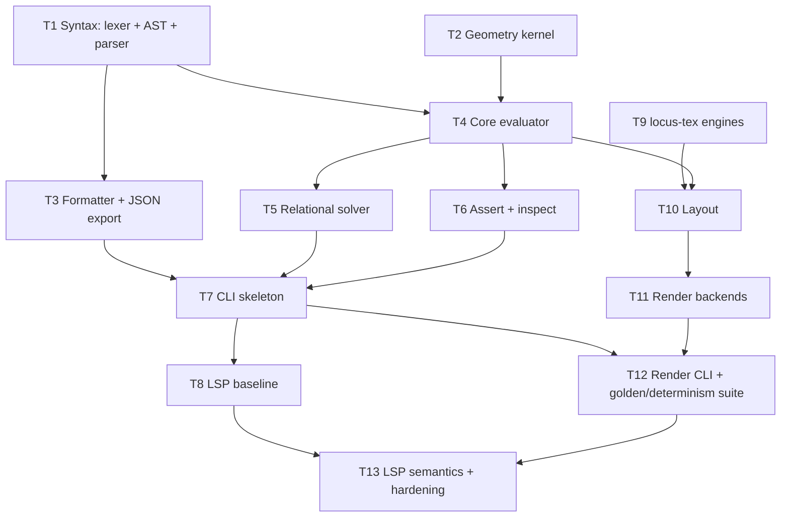

# Locus Implementation Plan — Multi-Agent Task Breakdown

This is a historical implementation plan. The current [`0 beta 4` specification](../spec/specification.md) supersedes these task prompts; the plan remains as an architectural record and does not describe supported compatibility modes.

This plan decomposes the full implementation of Locus (per `documents/specification.md` v0.3 and
`documents/structure.md`) into 13 self-contained tasks, each with a ready-to-send prompt for a
separate agent session. Tasks within the same wave have disjoint write scopes and can run in
parallel.

## Dependency graph



## Waves

| Wave | Tasks | Parallel? |
|---|---|---|
| 1 | T1, T2, T9 | yes — disjoint crates |
| 2 | T3, T4 | yes — T3 touches `locus-syntax`, T4 touches `locus-core` |
| 3 | T5, T6 | yes — `solve/` vs `assert.rs`/`inspect.rs` |
| 4 | T7 | solo |
| 5 | T8, T10, T11 | T8 parallel with T10→T11 (T11 waits on T10) |
| 6 | T12 | solo |
| 7 | T13 | solo |

Shared instructions to prepend to **every** prompt below:

> You are working in the Rust workspace at `/path/to/locus`. Before writing code,
> read `documents/specification.md` (the normative v0.3 spec) and `documents/structure.md` (the
> architecture contract) — at minimum the sections named in this task. Hard rules: geometry never
> depends on layout (crate dependency direction is `locus-syntax → locus-core → locus-layout →
> locus-render`); determinism is normative (spec §7.6): use `IndexMap`/`BTreeMap` only, never
> iterate `HashMap` where it affects output; math via the pinned `libm` crate, never system libm;
> all tolerance logic lives in one module; spans on every AST node flow through the whole
> pipeline; stable error codes E1xx (syntax) / E2xx (construction) / E3xx (dependency) / E4xx
> (layout) are never renumbered. Before finishing, run: `cargo fmt --all -- --check`,
> `cargo build --workspace --all-features --all-targets`,
> `cargo clippy --workspace --all-features --all-targets -- -D warnings`, and
> `cargo test --workspace --all-features --all-targets`, and report results.

---

## Wave 1

### T1 — `locus-syntax`: lexer, AST, parser, diagnostics

**Write scope:** `crates/locus-syntax/` only.

```text
Implement the Locus language frontend in `crates/locus-syntax` (currently a stub lib.rs).

Read `documents/specification.md` Part 1 (file identity, file shape, the full EBNF grammar in
§1.3, statement rules §1.4), Part 2 (free/derived tiers, hints `~`, `where` sugar), Part 3
(relation vocabulary — you only parse it, no evaluation), Part 5 (constructor names and props —
needed for `did you mean` tables), and Part 6 (expression language, mandatory deg/rad units).
Read `documents/structure.md` §2.1 for the module layout and key decisions.

Deliverables, following the module layout in structure.md §2.1:
- `span.rs`: `Span { line, col, byte range }` on every token and AST node.
- `lexer.rs`: hand-written lexer — idents, numbers with optional angle units (deg/rad), strings,
  TeX literals, punctuation, comments.
- `ast.rs`: `File`, `Statement`, `OpStmt { kind, id, ctor, attr, props, span }`, `RelStmt`,
  `AssertStmt`, `Expr` (Number/Tex/Ref/Call/Property/Binary), `Constructor`, `Props`, meta block.
  All AST types derive `serde::Serialize` (the parser itself never uses serde).
- `parser.rs`: hand-written recursive descent with per-line recovery — one bad line must produce
  a diagnostic and NOT kill the rest of the file. No parser generators (no nom/pest).
- `diag.rs`: `Diagnostic { code, span, message, notes, suggestion }` with stable E1xx codes, plus
  edit-distance "did you mean" suggestions against known constructor/prop/kind names (e.g.
  `incircel` → `incircle`).
- Public completion/vocabulary tables (constructor names, kinds, props, predicates, units)
  exported for later CLI/LSP reuse — single source of truth.

Testing: unit tests for lexer and parser; recovery tests (multiple bad lines, all reported);
diagnostic snapshot tests with `insta` covering at least 10 distinct E1xx errors including a
did-you-mean case; parse every file in `spec/test/stress/*.locus` successfully (they are format
version 2 stress tests — if any construct is genuinely outside the spec grammar, report it in
your final message rather than hacking the grammar).

Do not implement the formatter or JSON export (a follow-up task owns `format.rs`/`json.rs`).
Do not touch any other crate. Use only workspace dependencies from the root Cargo.toml.
```

### T2 — `locus-core`: geometry kernel (`geom/` + `tol.rs`)

**Write scope:** `crates/locus-core/src/geom/`, `crates/locus-core/src/tol.rs`, `crates/locus-core/src/lib.rs` (module wiring only).

```text
Implement the pure-math geometry kernel in `crates/locus-core` (currently a stub). This task has
NO dependency on the parser — do not import locus-syntax.

Read `documents/specification.md` Part 4 (coordinate/angle conventions), Part 5 (constructors,
§5.8 anchors, §5.9 domains and degeneracy), §6.2 (numeric functions), §7.4 (tolerance model:
relative epsilon 1e-9 × bbox diameter), and the branch-ordering rules for intersections.
Read `documents/structure.md` §2.2.

Deliverables, following structure.md's layout:
- `geom/mod.rs`: `Point`, `Vec2`, `Line`, `Ray`, `Segment`, `Circle`, `Arc`, `Polygon`, `BBox`.
  All arithmetic `f64`; every transcendental call goes through the pinned `libm` crate (add it to
  workspace deps), never std float intrinsics where results could differ across platforms.
- `geom/intersect.rs`: every type-pair intersection (line/line, line/circle, circle/circle,
  ray/segment variants, etc.) with the spec's deterministic branch-ordering rules for explicit
  branch index `k`, documented in comments next to the math.
- `geom/construct.rs`: derived constructors — midpoint, foot, project, reflect, rotate,
  tangent_line, incircle, circumcircle, centroid, and the rest of spec §5.1–§5.5.
- `geom/measure.rs`: dist, angle, dir_angle, area, perimeter, ratio-along-line.
- `tol.rs`: the SINGLE home of tolerance logic (relative epsilon per spec §7.4). No inline
  epsilons anywhere else — add a clippy `disallowed-methods`/review note if helpful.

Testing: known-answer unit tests per constructor (e.g. 3-4-5 triangle incircle/circumcircle,
equilateral centroid); branch-ordering unit tests per intersection type-pair (assert which root
is k=0 vs k=1); degenerate-input tests returning typed errors (E2xx-ready error enums with
`thiserror`); `proptest` sanity properties where cheap (e.g. reflect twice = identity within
tolerance). Do not touch eval/solve/inspect — later tasks own those modules.
```

### T9 — `locus-tex`: TeX measurement behind a trait

**Write scope:** `crates/locus-tex/` only.

```text
Implement `crates/locus-tex` (currently a stub): TeX/plain-text measurement and rendering behind
an engine trait, so no other crate ever knows which engine ran.

Read `documents/structure.md` §2.4 and `documents/specification.md` §8.1–§8.2 (label boxes,
mixed text/TeX segments) and §1.4 (text segmentation).

Deliverables:
- `TexEngine` trait exactly as structure.md sketches: `fn render(&self, tex: &str, size:
  FontSize) -> Result<TexBox, TexError>` where `TexBox` carries SVG body + em-relative measured
  box (width, height, depth/baseline).
- A `plaintext` engine for non-TeX labels using `rustybuzz`/`ttf-parser` font metrics with a
  bundled or clearly-documented default font. Deterministic output.
- A `MockEngine` (deterministic, metrics computed from a fixed per-char advance table) exported
  for use by golden tests in other crates.
- A ReX-based math engine behind a cargo feature (`rex`) if the ReX crate is viable on the pinned
  toolchain; if ReX proves unusable, implement the feature-gated seam anyway with a stub that
  returns a typed "engine unavailable" error, and say so in your final message. Do NOT add a
  Node/JS dependency.
- Mixed-segment API: given the ordered plain/TeX segments of a label, return one composed
  measured box.

Testing: unit tests for plaintext measurement determinism (same input twice → identical box),
mock engine stability, and segment composition. This crate must not depend on any other locus
crate except (optionally) shared error span types — prefer zero internal deps.
```

---

## Wave 2

### T3 — `locus-syntax`: canonical formatter + JSON export

**Write scope:** `crates/locus-syntax/src/format.rs`, `crates/locus-syntax/src/json.rs`, tests.

```text
Add the canonical formatter and JSON interchange export to `crates/locus-syntax`. The lexer,
AST, parser, and diagnostics already exist — read `crates/locus-syntax/src/` first and build on
them without restructuring.

Read `documents/specification.md` §1.2/§1.4 (file shape, statement rules), §9.4 (JSON
interchange contract: version, segmented meta text, style preset, declared classes, ordered ops
as {id, kind, def, hint, where, attr, props} with def as BOTH source string and parsed tree,
rels, asserts, inferred numeric dimensions per §6.1, ordered plain/TeX text segments), and
`documents/structure.md` §2.1 (formatter with `=` alignment).

Deliverables:
- `format.rs`: canonical formatter for `locus fmt` — stable statement layout, `=` alignment,
  canonical spacing, comment preservation, deterministic output.
- `json.rs`: AST → interchange JSON via serde matching §9.4 exactly. Field order stable
  (serde struct order), numbers formatted deterministically.

Testing (this is the core of the task):
- `proptest` round-trip: `parse(fmt(parse(x))) == parse(x)` over a generator of valid files.
- Formatter idempotence: `fmt(fmt(x)) == fmt(x)` on generated files AND on every
  `spec/test/stress/*.locus` fixture.
- `insta` snapshots of formatted output and JSON output for at least 3 of the `spec/test`
  fixtures.

Do not modify parser behavior except bug fixes required by round-trip testing (call those out in
your final message). Do not touch other crates.
```

### T4 — `locus-core`: evaluator, environment, scene

**Write scope:** `crates/locus-core/src/eval/`, `crates/locus-core/src/scene.rs`, `lib.rs` wiring; adds `locus-syntax` dependency to `locus-core/Cargo.toml`.

```text
Implement the derived-tier evaluator in `crates/locus-core`. The geometry kernel (`geom/`,
`tol.rs`) and the parser (`locus-syntax`) already exist — read both crates' public APIs first.

Read `documents/specification.md` Part 2 (derived tier = direct, zero unknowns), Part 5
(constructors and props, §5.8 anchors, §5.9 domains/degeneracy), Part 6 (expression language,
dimension inference, mandatory deg/rad), §7.5 (construction error format: measured values +
source spans), and `documents/structure.md` §2.2.

Deliverables, per structure.md layout:
- `eval/env.rs`: id → `ResolvedObject` environment, insertion order = file order (`IndexMap`).
- `eval/expr.rs`: expression evaluator with `Value: Scalar | Angle | ObjectRef | Bool` — `Angle`
  is a distinct variant so `rotate(P, O, 2 * 30deg)` type-checks and `rotate(P, O, 60)` fails
  with a typed error. Numeric functions from spec §6.2 dispatch into `geom/measure.rs`.
- `eval/mod.rs`: top-to-bottom evaluation of a parsed `File` into a `ResolvedScene { objects:
  IndexMap<Ident, ResolvedObject>, bbox }`. Annotations resolve to `AnnotationSpec` (position is
  layout's job later).
- `eval/deps.rs`: dependency graph extraction; orphan detection to support future update/remove
  (E3xx dependency errors).
- `eval/error.rs`: E2xx construction errors carrying spans and measured values (e.g. "circles
  are 3.2 apart but radii sum to 2.9").
- `scene.rs`: `Scene` = parsed File + ResolvedScene + recompute API.

Free objects (`free` points/nums with rels) are OUT of scope here — when a file contains
unknowns, evaluate the derived prefix and return a typed "requires solve" placeholder that a
follow-up solver task will replace. Design the seam so the solver can slot in (e.g. an
`Unresolved` state, not a panic).

Testing: evaluator unit tests with hand-computed scenes; dimension-inference tests; E2xx
diagnostic snapshot tests (`insta`) for degenerate constructions; dependency-graph tests
(orphans, forward references rejected). Evaluate the purely-derived subset of `spec/test`
fixtures end-to-end where possible.
```

---

## Wave 3

### T5 — `locus-core`: relational solver (spec Part 7)

**Write scope:** `crates/locus-core/src/solve/`, minimal integration edits in `eval/mod.rs`/`scene.rs`.

```text
Implement the relational constraint solver in `crates/locus-core/src/solve/`. The geometry
kernel and derived-tier evaluator already exist — read `crates/locus-core/src/` first; there is
a designed seam where files containing free objects currently return an "requires solve" state.
Replace that seam with the real solve.

Read `documents/specification.md` Part 3 (relation vocabulary and residual semantics), §2.2–§2.4
(free tier, hints `~` as branch selectors, `where` sugar), and ALL of Part 7 — §7.1 solve
algorithm (Levenberg–Marquardt with the fixed schedule), §7.2 DOF accounting via Jacobian rank,
§7.3 failure taxonomy (under-constrained, over-constrained, conflicting, non-convergence — each
with its specified report content), §7.4 tolerance, §7.6 determinism.

Deliverables:
- LM solver with the exact fixed schedule from §7.1. All math through `libm` for bit-identical
  cross-platform results. Unknown ordering and equation ordering = file order.
- Residual functions for every `rel` relation in spec §3.2.
- Hints: initial guesses AND branch selection; report hint displacement distances (for
  `describe`'s hint-displacement output and the `hint_far` diagnostic).
- DOF accounting: Jacobian-rank analysis producing the under/over-constraint reports from §7.3,
  including which relations/unknowns are implicated.
- Solve summary struct (iterations, final residual, DOF report, branch resolutions) exposed for
  `describe`/`check`.

Testing (the spec test matrix in structure.md §4): known-answer relational fixtures — tangency,
alignment, mixed systems; DOF-accounting tests for under/over/conflicting systems; hint-branch
tests (identical relations, different hints → different documented solutions); determinism test
(solve twice, bit-identical results); non-convergence produces the §7.3 report, never a panic.
Get the relationally-constrained `spec/test` fixtures (e.g. tangent_circles.locus,
angle_bisector_ratio.locus) solving with plausible summaries. Do not modify `assert.rs` or
`inspect.rs` (another task owns those in parallel).
```

### T6 — `locus-core`: assert + inspect

**Write scope:** `crates/locus-core/src/assert.rs`, `crates/locus-core/src/inspect.rs`, tests.

```text
Implement assertion evaluation and scene inspection in `crates/locus-core` — these are the
agent's eyes and are first-class features. The geometry kernel, evaluator, and expression
`Value` type already exist; read `crates/locus-core/src/` first.

Read `documents/specification.md` §3.2 (relation vocabulary — every relation is also an assert
predicate), §3.3 (assert-only predicates incl. comparisons), §6.3 (predicate summary), §7.4
(tolerance — all comparisons go through the central `tol.rs`), and §9.3: on assert failure the
report must include the actual value of EVERY measurable subterm so an agent can localize the
wrong upstream definition. Read `documents/structure.md` §2.2 (inspect is not an afterthought).

Deliverables:
- `assert.rs`: evaluate assert statements against a resolved scene; pass/fail per assert; on
  failure, walk the predicate expression tree and report each subterm's actual value with spans.
  Results are `Serialize` structs (the CLI will render them human/JSON).
- `inspect.rs` per spec §9.3: measurement tables (pairwise distances among named points,
  triangle angles, ratios along shared lines), detected incidences (tangency, point-on-object,
  ratio detection along shared lines, e.g. "M on AB with AM:MB = 1:1"), and diagnostics:
  `degenerate`, `hint_far`, `out_of_view` (geometry bbox based), `crowding`, `unreferenced`.
  Emit `label_collision` as a variant that layout will populate later — define the type now.
  All detection thresholds via `tol.rs`; all output ordering deterministic (file order, then
  lexicographic).

Testing: fixture-driven unit tests for each incidence type; assert subterm-reporting snapshot
tests with `insta` (failing asserts on a known scene); tolerance boundary tests (just inside /
just outside epsilon). Do not touch `solve/` (a parallel task owns it) — if you need a solved
scene for tests, construct resolved scenes directly from geom types.
```

---

## Wave 4

### T7 — `locus-cli`: the agent-facing binary

**Write scope:** `crates/locus-cli/`, `spec/test/demonstrations/`, `fixtures/errors/`.

```text
Implement the `locus` CLI in `crates/locus-cli` (currently a stub main.rs). All language and
geometry logic already exists in `locus-syntax` and `locus-core` — the CLI must stay a thin
shell; read both crates' public APIs first.

Read `documents/specification.md` Part 9 in full (§9.1 commands, §9.2 exit codes 0/1/2/3, §9.3
output conventions, §9.4 JSON, §9.5 the agent loop) and `documents/structure.md` §2.6.

Deliverables:
- `main.rs` with clap derive; subcommands: `init` (--style textbook), `add` (append from stdin,
  whole file re-validated), `update` (--id X --def "<rhs>" / --set 'key=value', re-solve),
  `remove` (--id X, orphaned dependents → exit 2), `describe` (objects, defs, resolved
  positions, solve summary, DOF report, hint displacements, branch resolutions), `inspect`
  (measurements, incidences, diagnostics), `check` (solve + diagnostics + all in-file asserts;
  warnings non-fatal unless --strict), `fmt` ([--json] via locus-syntax). `render` is a later
  task: register the subcommand but exit with a clear "not implemented in this build" error.
- `output.rs`: every command's result is a `Serialize` struct FIRST, then rendered either as
  JSON (--json, stdout) or human-readable via miette (source snippet + caret + suggestion, spec
  §7.5 format). Never format prose ad-hoc inside command functions.
- `exit.rs`: exit code mapping exactly per §9.2 — 0 success, 1 assert failure/strict warnings,
  2 solve/construction/dependency error, 3 usage/parse error.

Testing with `assert_cmd`:
- The full agent loop from §9.5: init → add via stdin → check --json → render (expect the
  not-implemented error) as an end-to-end test.
- Exit-code tests for all four codes.
- `update`/`remove` flows including orphan detection (exit 2).
- Keep compact figures in `spec/test/demonstrations/` and add `insta` snapshot tests of
  `describe --json` and `inspect --json` for each one that solves.
- Author at least 8 invalid files in `fixtures/errors/` and snapshot their diagnostics (both
  human and --json forms) — error UX is a feature, test it like one.
```

---

## Wave 5

### T8 — `locus-lsp`: language server baseline

**Write scope:** new crate `crates/locus-lsp/`, one-line member addition if needed in root `Cargo.toml`.

```text
Create the `crates/locus-lsp` crate (it does not exist yet — add it under crates/ so the
workspace `members = ["crates/*"]` glob picks it up) implementing a standard LSP 3.17 server
over stdio for the Locus language. It may depend on locus-syntax and locus-core ONLY — never on
layout/tex/render (editor feedback is text-first and must not start a rendering toolchain).

Read `documents/structure.md` §2.7 in full — it is the contract for this task — plus
`documents/specification.md` Part 1 (language shape) and §7.5 (diagnostic format).

Deliverables, per structure.md's module layout (main.rs, server.rs, state.rs, document.rs,
capabilities.rs, diagnostics.rs, handlers/):
- Synchronous `lsp-server` transport + `lsp-types` models (already in workspace deps). No async
  runtime.
- Document sync: versioned text, full reparse per debounced change; every analysis result
  carries the document version and stale results are discarded before publication.
- `document.rs` owns ALL UTF-16 ↔ byte-span conversion; internal spans stay byte-based and
  identical to CLI spans.
- Live diagnostics: E1xx from locus-syntax always; E2xx/E3xx from locus-core only when the
  document has a valid evaluable prefix. LSP `code` = stable Locus code; structured details in
  `Diagnostic.data`.
- Completion sourced from the vocabulary tables exported by locus-syntax (statement kinds,
  constructors, defined ids, properties, enum values, predicates, units) — do NOT maintain a
  second vocabulary.
- Hover (inferred kinds, constructor signatures, resolved measurements when evaluation
  succeeds), go-to-definition, document formatting via the locus-syntax canonical formatter,
  document symbols.
- References, rename, semantic tokens, and code actions are a LATER task — advertise only what
  you implement in `capabilities.rs`.

Testing: in-memory JSON-RPC transcript tests covering initialization handshake, open/change/save
diagnostics, completion, hover, definition, formatting, symbols, shutdown, stale-version
suppression, and a UTF-16 position edge case (multi-byte char before an error).
```

### T10 — `locus-layout`: annotation placement

**Write scope:** `crates/locus-layout/` only.

```text
Implement `crates/locus-layout` (currently a stub): deterministic label/annotation placement.
Inputs: a `ResolvedScene` from locus-core plus measured text boxes from locus-tex. Output: a
`LayoutScene` where every annotation has a final box + leader info. Layout runs strictly AFTER
geometry and must never feed back into it; there is no solver here.

Read `documents/specification.md` §8.1 (candidate/scoring placement: 8 directions × 2 radii,
domain preferences like external angle bisector for angle labels), §8.2 (mixed text/TeX boxes),
§5.6–§5.8 (annotation kinds, props like `dir=NE`, anchors), and `documents/structure.md` §2.3.
Read the public APIs of locus-core (ResolvedScene, AnnotationSpec) and locus-tex (TexBox,
MockEngine) first.

Deliverables per structure.md layout:
- `candidates.rs`: candidate generation — 8 dirs × 2 radii plus domain-specific preferred
  positions; explicit `dir=` props pin the candidate.
- `boxes.rs`: label box geometry from locus-tex measurements (or plaintext).
- `score.rs`: penalties for stroke overlap, label-label overlap, margin violations.
- `assign.rs`: greedy most-constrained-first assignment with a documented deterministic
  tie-break (candidate index order, then id order).
- `report.rs`: residual collisions → `label_collision` diagnostics feeding locus-core's
  inspect diagnostic type.

Testing: known-scene unit tests (a labeled triangle where optimal placements are hand-checkable);
determinism test (same scene twice → identical LayoutScene); crowding test where collisions are
unavoidable and must be reported, not silently overlapped; tests use locus-tex's MockEngine.
```

### T11 — `locus-render`: SVG + TikZ backends

**Write scope:** `crates/locus-render/` only. Starts after T10.

```text
Implement `crates/locus-render` (currently a stub): SVG (primary), TikZ (secondary), and
feature-gated PNG backends over a LayoutScene from locus-layout.

Read `documents/specification.md` §8.3 (style system: the `textbook` preset, semantic classes →
stroke/dash/color; declared classes from the file), §8.4 (viewport: auto-fit over geometry ∪
label boxes, margin, y-flip to SVG coordinates) and `documents/structure.md` §2.5.
Read locus-layout's and locus-core's public output types first.

Deliverables per structure.md layout:
- `viewport.rs`: auto-fit viewport (geometry bbox ∪ label boxes), margin, y-axis flip.
- `style.rs`: `textbook` preset; semantic class resolution to concrete stroke/dash/color;
  user-declared classes override.
- `svg.rs`: the primary backend. Deterministic float formatting is THE critical requirement for
  byte-identical output: one central formatting function, fixed precision, `ryu`-based, no
  locale involvement, negative-zero normalized. Test it directly.
- `tikz.rs`: emits a `tikzpicture` from the SAME resolved layout so TikZ output is geometrically
  identical to SVG.
- `png.rs` behind a `png` cargo feature: rasterize our own SVG via `resvg`; default build stays
  lean (no resvg in default deps).

Testing: unit tests for the float formatter (precision, -0, large/small magnitudes); viewport
tests; `insta` snapshots of full SVG and TikZ output for at least 2 hand-built LayoutScenes;
byte-determinism test (render the same scene twice, assert byte-equal strings).
```

---

## Wave 6

### T12 — Render CLI, golden fixtures, determinism gates

**Write scope:** `crates/locus-cli/` (render command + wiring), `fixtures/golden/`, `spec/test/demonstrations/`, `.github/workflows/ci.yml`.

```text
Complete the pipeline end-to-end: wire `locus render` into the CLI and build the golden-file and
determinism test suite. Everything upstream exists: syntax, core (eval/solve/assert/inspect),
tex, layout, render, and a CLI with all other subcommands. Read `crates/locus-cli/src/` and the
public APIs of locus-tex, locus-layout, locus-render first.

Read `documents/specification.md` §9.1 (render command: `locus render <file> -o out.svg [--png]
[--tikz] [--stdout]`), §7.6 (determinism is normative), §9.5 (agents should never render until
check exits 0 — but render must still work regardless), and `documents/structure.md` §4 (the
testing matrix — this task implements its bottom half).

Deliverables:
- `commands/render.rs`: parse → eval/solve → layout (with the real text engine by default; the
  deterministic MockEngine under a test/hidden flag such as `--tex-engine=mock` or an env var,
  documented) → render; `-o`, `--png` (behind the png feature), `--tikz`, `--stdout`.
- Golden suite: for every figure in `spec/test/demonstrations/` (including
  tangent_circles and angle_bisector_ratio), commit expected `describe --json`,
  `inspect --json`, and rendered SVG (mock text engine) under `fixtures/golden/`, with `insta`
  or file-comparison tests.
- Determinism harness: a test that runs the FULL pipeline twice per fixture and asserts
  byte-equal SVG output.
- CI: extend `.github/workflows/ci.yml` to run the existing check commands plus the test suite
  on BOTH ubuntu-latest and macos-latest to catch platform float drift, without weakening any
  existing gate.

Report any fixture whose golden output looks geometrically suspicious in your final message
instead of silently committing it.
```

---

## Wave 7

### T13 — LSP semantics fill + project hardening

**Write scope:** `crates/locus-lsp/`, `README.md`, `spec/README.md`, small fixes anywhere flagged.

```text
Two-part finishing task on the Locus workspace.

Part A — complete the language server (crates/locus-lsp; baseline with diagnostics, completion,
hover, definition, formatting, and symbols already exists — read it first, plus
`documents/structure.md` §2.7):
- References and file-local rename.
- Semantic tokens: operations, assertions, references, numbers/units, strings, TeX literals,
  comments, properties, semantic style attributes.
- Safe code actions sourced directly from diagnostics: spelling replacements (did-you-mean),
  adding missing mandatory angle units when unambiguous, canonical property/attribute
  replacements. No action may silently change geometry or choose a construction branch.
- Update capabilities.rs and add transcript tests for each new feature, including rename across
  references and a code-action round trip.

Part B — hardening and docs:
- The root README.md references `spec/README.md`, which does not exist — write it: the normative
  contract summary, how the demonstration and stress corpora relate to `fixtures/`, and how
  `scripts/check_spec.py` gates spec changes.
- Update the root README.md: replace the "Phase 0 bootstrap" paragraph with an accurate current
  status, document install/usage (`locus init/add/check/render`, the §9.5 agent loop), and the
  LSP binary.
- Sweep for TODOs/`unimplemented!` left by earlier tasks across all crates; fix trivial ones,
  list non-trivial ones in your final message.
- Verify `python3 scripts/check_spec.py` still passes alongside the full cargo gate.
```

---

## Coordination notes for the orchestrator

- **Prepend the shared instructions block** (top of this file) to every prompt.
- **Disjoint write scopes** are stated per task; enforce them when running tasks in parallel
  (T5/T6 both touch `locus-core` but own different modules — the only shared file risk is
  `lib.rs` module wiring; have T5 own `lib.rs` edits and T6 declare its modules via T5 or accept
  a trivial merge).
- After each wave, run the full gate (`fmt`, `build`, `clippy -D warnings`, `test`,
  `scripts/check_spec.py`) before starting the next wave.
- If a task reports a spec ambiguity, resolve it against `documents/specification.md` Part 12
  (decided questions) before unblocking dependents; record new decisions in the spec, not in
  code comments.
